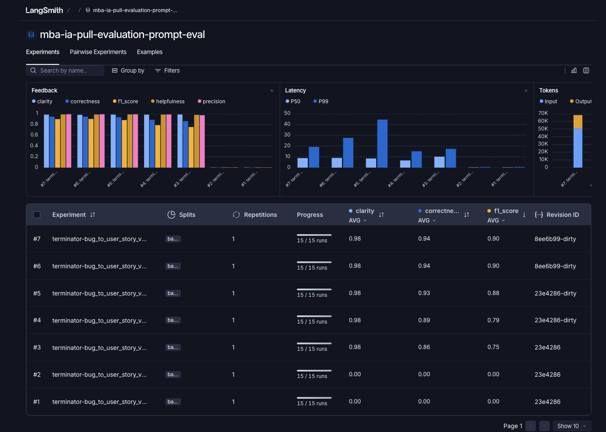

# Otimização e Avaliação de Prompts

Projeto para transformar relatos de bugs em histórias de usuário claras e testáveis. O prompt é publicado no LangSmith Prompt Hub e avaliado com um dataset de 15 exemplos.

## Como Executar

### Pré-requisitos

- Python 3.10 ou superior
- Conta e chave de API do LangSmith
- Chave de API do Google Gemini ou da OpenAI

### Instalação e configuração

Na primeira configuração, abra um terminal na pasta raiz do repositório e crie o ambiente virtual:

**macOS / Linux**

```bash
python3 -m venv venv
source venv/bin/activate
pip install -r requirements.txt
cp .env.example .env
```

**Windows (PowerShell)**

```powershell
py -3 -m venv venv
.\venv\Scripts\Activate.ps1
pip install -r requirements.txt
Copy-Item .env.example .env
```

**Windows (Prompt de Comando / CMD)**

```bat
py -3 -m venv venv
venv\Scripts\activate.bat
pip install -r requirements.txt
copy .env.example .env
```

O ambiente está ativo quando o nome `venv` aparece no início do prompt do terminal. Se abrir outro terminal ou reiniciar a sessão, entre novamente na pasta do repositório e ative o ambiente já criado:

```bash
# macOS / Linux
source venv/bin/activate
```

```powershell
# Windows (PowerShell)
.\venv\Scripts\Activate.ps1
```

```bat
REM Windows (Prompt de Comando / CMD)
venv\Scripts\activate.bat
```

Para sair do ambiente virtual, execute `deactivate` no terminal. Não é necessário recriar o ambiente nem reinstalar as dependências ao reabri-lo.

Preencha o `.env` local com as credenciais e configurações necessárias. Não versione esse arquivo. Configure `LANGSMITH_API_KEY`, `LANGSMITH_PROJECT`, `USERNAME_LANGSMITH_HUB`, `LLM_PROVIDER`, `LLM_MODEL` e `EVAL_MODEL`; adicione a chave correspondente em `GOOGLE_API_KEY` ou `OPENAI_API_KEY`.

O prompt foi avaliado com o provider `google` e `gemini-3.8-flash` tanto para geração quanto para avaliação. Consulte a disponibilidade atual do modelo no provedor antes de executar.

### Fluxo de execução

Execute os comandos na raiz do repositório, com o ambiente virtual ativado:

```bash
# Baixa o prompt semente do LangSmith para prompts/bug_to_user_story_v1.yml
python src/pull_prompts.py

# Publica prompts/bug_to_user_story_v2.yml no LangSmith Prompt Hub
python src/push_prompts.py

# Avalia a versão publicada no dataset existente de 15 exemplos
python src/evaluate.py

# Executa os testes de validação
pytest tests/test_prompts.py tests/test_push_prompts.py
```

## Técnicas Aplicadas

### Role Prompting

**O que define:** atribui ao modelo um papel e um contexto de atuação.

**Por que foi aplicada:** a perspectiva de Product Owner ajuda a identificar a necessidade da pessoa usuária e o benefício esperado, sem reduzir a resposta a uma proposta de implementação.

**Exemplo do prompt:**

```text
Você é um Product Owner experiente em transformar relatos de defeitos em histórias de usuário claras, úteis e testáveis para equipes de produto e engenharia.
```

### Few-shot Learning

**O que define:** demonstra a tarefa com exemplos de entrada e saída.

**Por que foi aplicada:** os exemplos mostram como cobrir resultados observáveis em relatos simples, validação, interface, dashboard, modais e problemas complexos sem deixar detalhes importantes implícitos. O prompt contém seis exemplos completos.

**Exemplo do prompt:**

```text
Entrada:
O botão "Adicionar ao Carrinho" não faz nada na página do produto. O cliente não vê confirmação e o contador do carrinho continua igual.

Saída:
**História de Usuário**
Como um cliente visualizando um produto, eu quero adicioná-lo ao carrinho, para que eu possa comprá-lo ao finalizar minhas compras.

**Critérios de Aceitação**
- Dado que estou visualizando um produto, quando clico em "Adicionar ao Carrinho", então o produto deve ser adicionado ao carrinho.
- Após a inclusão, devo ver uma confirmação e o contador do carrinho deve ser atualizado.
```

### Skeleton of Thought

**O que define:** organiza a resposta em seções predefinidas.

**Por que foi aplicada:** uma estrutura consistente facilita a revisão e mantém critérios, fatos técnicos, requisitos técnicos, tarefas e métricas nos lugares apropriados. Seções condicionais evitam perguntas ou conteúdo técnico sem necessidade.

**Exemplo do formato definido no prompt:**

```text
**História de Usuário**
Como [persona], eu quero [necessidade], para que [benefício].

**Critérios de Aceitação**
- Dado que [contexto], quando [ação], então [resultado verificável].

**Critérios Técnicos**
- [Especificação técnica explícita no relato.]

**Tarefas Técnicas Sugeridas**
- [Tarefa agrupada na fase correspondente.]

**Métricas de Sucesso**
- [Indicador: valor atual → meta.]
```

## Resultados Finais

A avaliação final usou o dataset original de 15 exemplos, sem alterações. O critério adotado é estrito: **cada uma das cinco métricas em cada exemplo deve ser igual ou superior a 0.8**. A média agregada, sozinha, não determina aprovação.

| Métrica | Média final | Menor nota individual | Limite |
|---|---:|---:|---:|
| Helpfulness | 0.98 | 0.965 | 0.8 |
| Correctness | 0.94 | 0.8971 | 0.8 |
| F1-Score | 0.90 | 0.8242 | 0.8 |
| Clarity | 0.98 | 0.96 | 0.8 |
| Precision | 0.99 | 0.95 | 0.8 |

Foram conferidas as 75 notas individuais (cinco métricas em cada um dos 15 exemplos); todas atingiram o limite.

### Comparação entre o prompt original e o otimizado

O prompt original ([v1](./prompts/bug_to_user_story_v1.yml)) tinha instruções genéricas, repetia `{bug_report}` no system e no user prompt, não definia uma persona clara e não apresentava exemplos nem critérios de aceitação verificáveis.

O prompt otimizado ([v2](./prompts/bug_to_user_story_v2.yml)) separa instruções de sistema do relato do usuário, define a persona de Product Owner, estabelece regras para preservar fatos e tratar lacunas, exige critérios observáveis e inclui exemplos para diferentes tipos e níveis de complexidade. Também orienta a preservar especificações, tarefas e métricas fornecidas no relato, distinguindo requisitos de recomendações.

### Evidências no LangSmith

- [Dataset público de avaliação — 15 exemplos e experimentos](https://smith.langchain.com/public/8bda8e60-d51c-4649-a23f-b850b4f59cde/d)
- [Prompt publicado no LangSmith Prompt Hub](https://smith.langchain.com/prompts/bug_to_user_story_v2/5dc7a4f3?organizationId=b910c5c3-128f-49f1-990b-135157bcf4b4)

O dashboard abaixo mostra o dataset, os experimentos registrados, os cinco indicadores de feedback e a execução final concluída em 15/15 exemplos. A tabela de resultados acima informa os menores valores individuais; os traces públicos permitem inspecionar cada execução em detalhe.



Os três traces públicos abaixo mostram exemplos de diferentes níveis de complexidade. Cada página permite consultar a árvore de execução, a entrada, a saída e os feedbacks das cinco métricas:

- [Exemplo simples — inclusão de produto no carrinho](https://smith.langchain.com/public/a39ccea5-efb3-47c0-98b6-46f5f28546ee/r)
- [Exemplo médio — webhook de pagamento](https://smith.langchain.com/public/539f3c11-c01d-422b-b12d-2ff271956c57/r)
- [Exemplo complexo — sincronização offline](https://smith.langchain.com/public/c7a2d5e1-a0ff-45bb-b667-2026e205e164/r)
